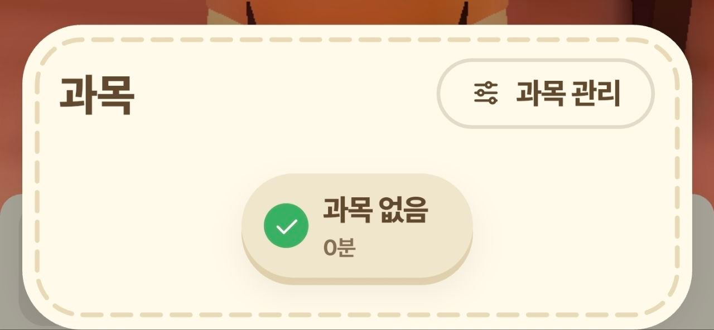
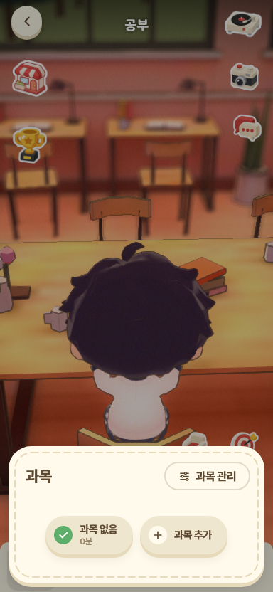
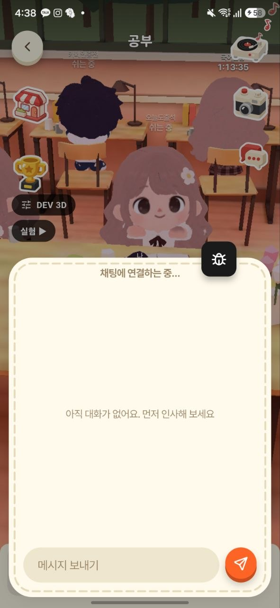
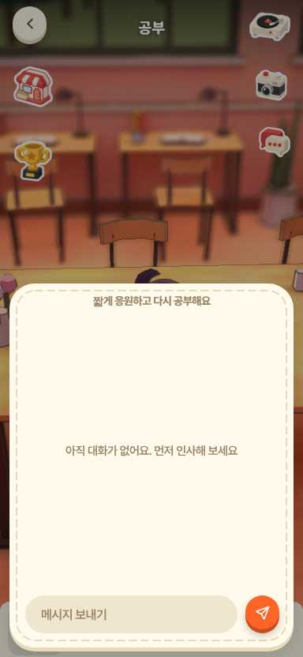
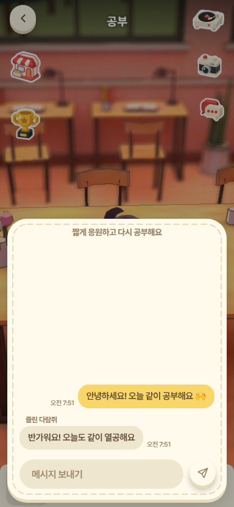
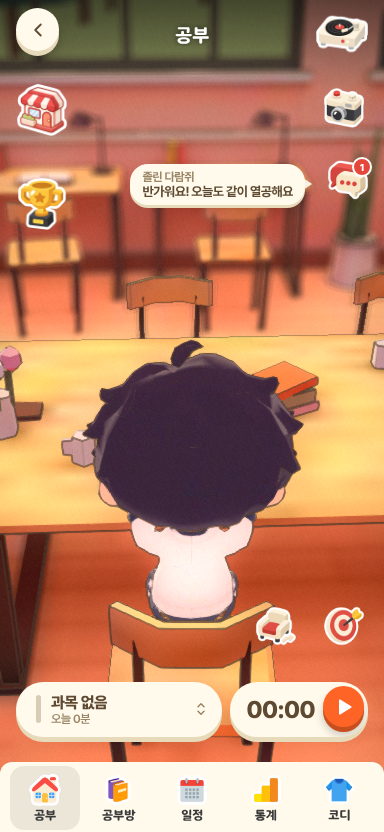
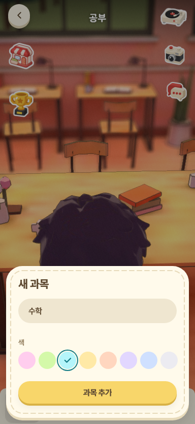
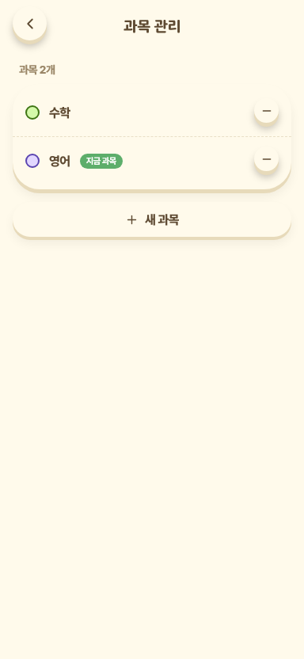

# 채팅 · 과목 고르기/관리 비교

기준은 사용자가 준 안드로이드 기기 캡처 2장(`chat-subject/app-*.png`)이다. 이번 작업 환경에는
PocketTime 저장소가 없어 앱 코드 값(`study_chat_sheet` 등)을 읽지 못했다. 캡처를 384 폭으로 환산해
맞췄고, 캡처에 없는 화면은 기존 섬 컴포넌트(IslandSurface·IslandButton·IslandIconButton)로 만들었다.
**앱 코드로 다시 확인해야 한다.**

| 화면 | 앱 | 웹 |
| --- | --- | --- |
| 과목 고르기 시트 |  |  |
| 채팅 시트(빈 상태) |  |  |
| 채팅 메시지 | 캡처 없음 |  |
| 새 말 미리보기·안 읽은 수 | 캡처 없음 |  |
| 새 과목 시트 | 캡처 없음 |  |
| 과목 관리 화면 | 캡처 없음 |  |

## 캡처에서 맞춘 것

- 크림 종이 시트: 양옆·아래 12, 모서리 32, 안쪽 9에 점선(굵기 2, 대시 9·틈 6, 모서리 24).
- 과목 시트: 제목 "과목" 왼쪽, "과목 관리" 테두리 알약 + 조절 아이콘 오른쪽, 칩 가운데 정렬.
  고른 칩은 초록 체크 동그라미, 칩 설명은 오늘 그 과목 시간("0분").
- 채팅 시트: 위 가운데 연결 안내, 비면 가운데 안내 한 줄, 아래 알약 입력칸(높이 48)과 주황 보내기 단추
  (입력칸이 비어도 주황).

## 확인하지 못한 값 (앱 코드로 확인 필요)

| 항목 | 웹에 둔 값 | 이유 |
| --- | --- | --- |
| 채팅 시트 높이 | min(461px, 100dvh − 120px) | 캡처의 461dp |
| 연결된 뒤 위 안내 | `studyChatCaption` | ARB에 "채팅 시트 설명"으로 있어서. 제목 `studyChatTitle`은 대화상자 이름으로만 |
| 말풍선 | 남: `--i-muted`, 나: `--i-sun`, 모서리 18, 이름은 연속된 첫 말에만, 시각 `오후 4:38` | 캡처 없음 |
| 새 말 미리보기 유지 시간 | 4000ms(`chatPeekMs`) | 원본 값 모름 |
| 새 과목 기본 색 | 고르기 전엔 저장하지 않음(원본 규칙: 이름 코드 합) | 원본 기본값 모름 |
| 과목 관리 화면 배치 | 크림 바탕, "과목 n개" + 카드 한 장(줄: 색·이름·"지금 과목"·빼기), 아래 "새 과목" | 캡처 없음 |
| 과목 지우기 되돌리기 단추 | `todoUndo`("되돌리기") | study ARB에 없음 |
| 앱 캡처의 디버그(벌레) 단추 | 넣지 않음 | 앱 디버그 빌드 전용으로 보임 |
