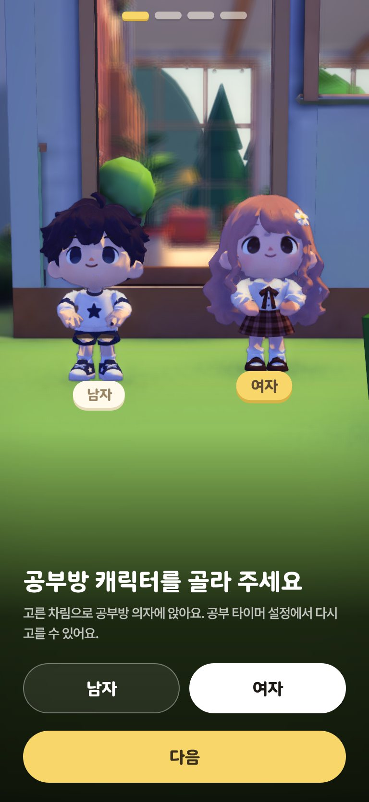
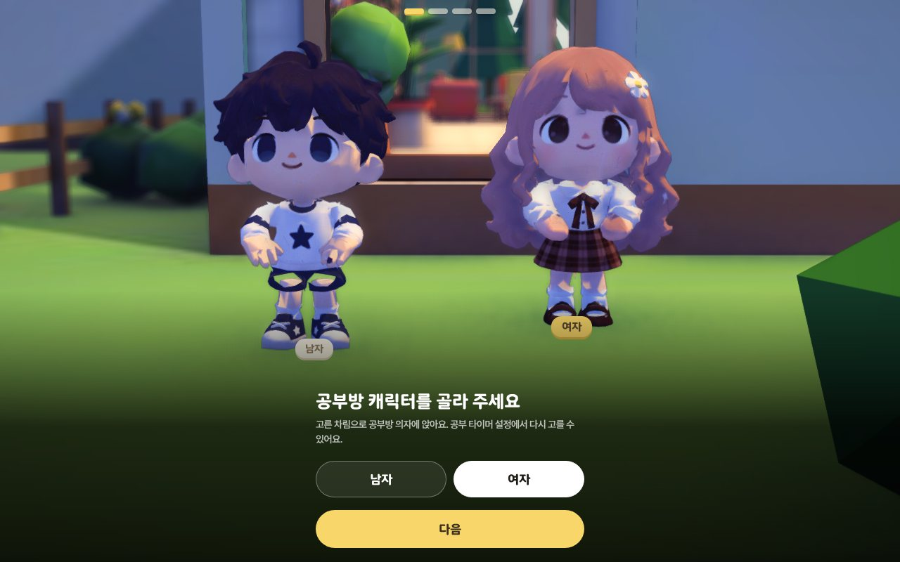
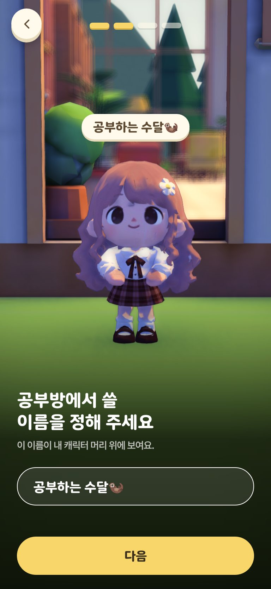
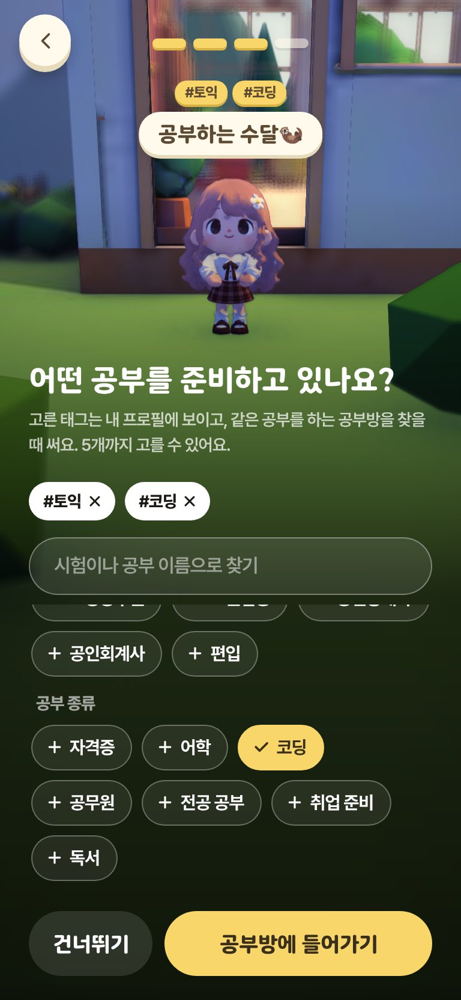
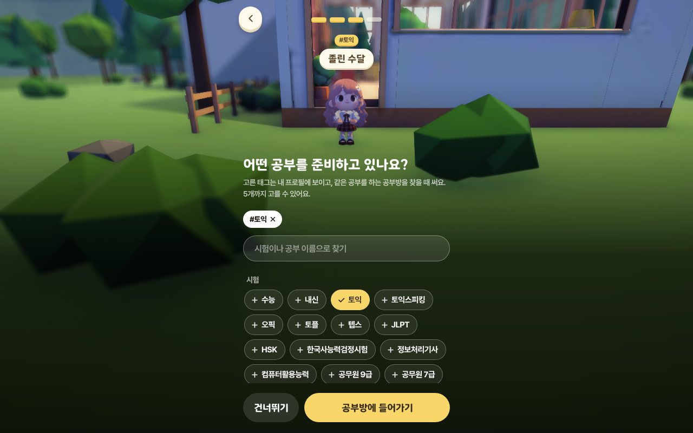
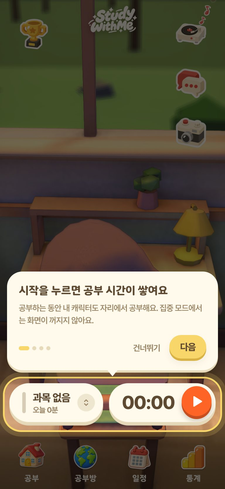
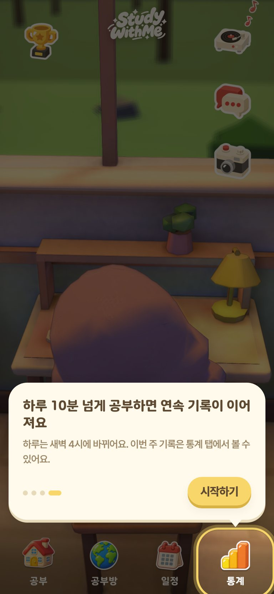
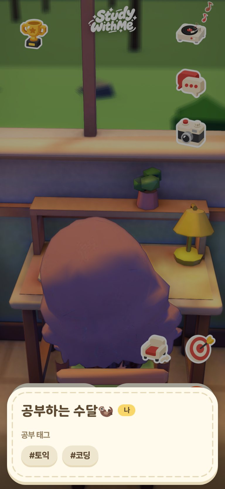

# 첫 가입 온보딩 (앱에 없는 흐름)

앱 비교 대상이 없다(앱은 공부방 첫 방문 소개 카드만 넘긴다). 결정과 다르게 둔 것은 `exceptions.md`의 "첫 가입 온보딩"·
"캐릭터 프로필 시트" 줄. 캡처는 목 데이터(`npm run dev:mock`, "새 개발용 계정으로 로그인"), 384px·1280px, 낮 시각.

| 단계 | 휴대폰 384 | 넓은 화면 1280 |
| --- | --- | --- |
| 1 캐릭터 |  |  |
| 2 이름 |  | |
| 3 목표 태그 |  |  |
| 4 걸어 들어가기 |  | |
| 4 둘러보기(타이머·연속 기록) |   | |
| 캐릭터 프로필 시트 |  | |

## 앱 문구와 웹이 어긋나는 곳(문구는 고치지 않음)

- `studyOnboardingGenderDescription` "공부 타이머 설정에서 다시 고를 수 있어요": 웹에는 아직 성별을 다시 고르는 설정이 없다.
- `studyOnboardingRoomsDescription` "공부방을 만들고 친구를 초대하면": 웹에는 아직 방 만들기·초대가 없다.
- `studyOnboardingSoundsDescription` "오른쪽 위 공부 사운드": 웹도 오른쪽 위라 맞다.
